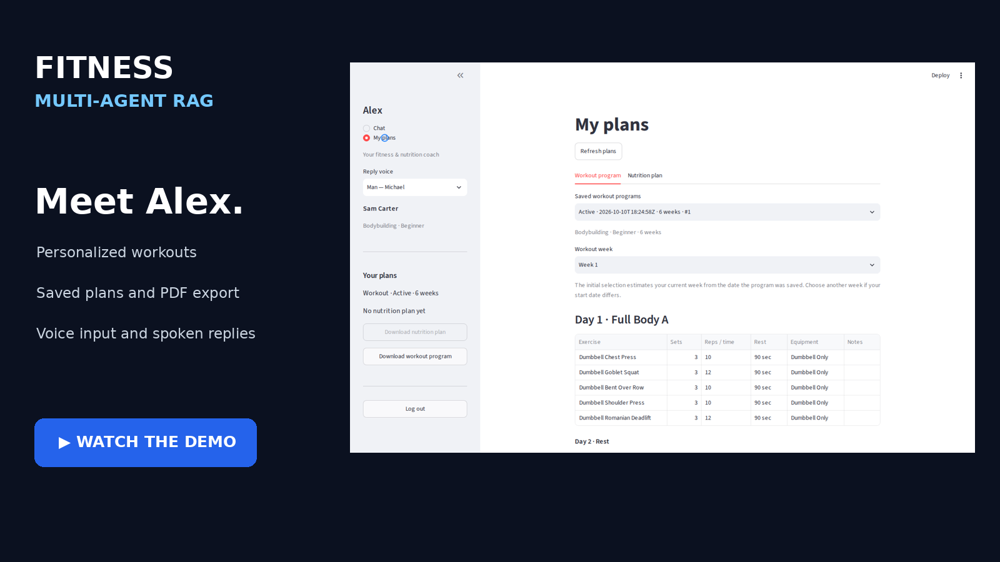
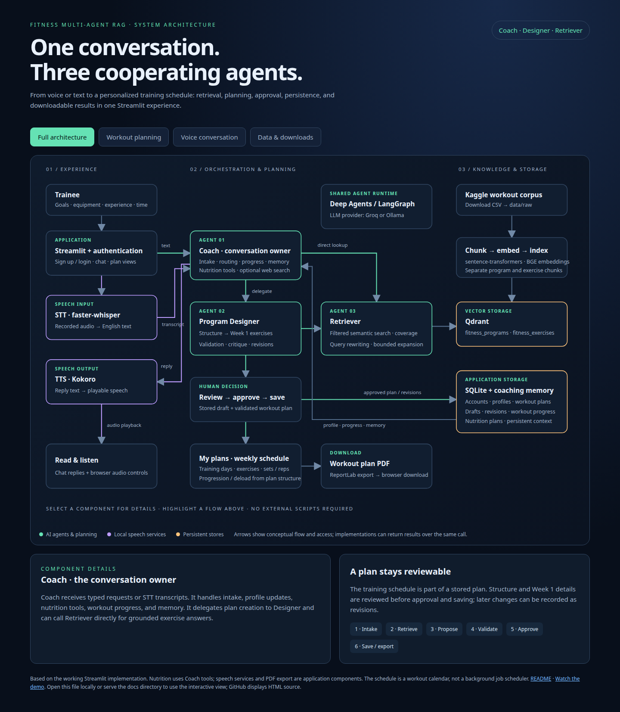
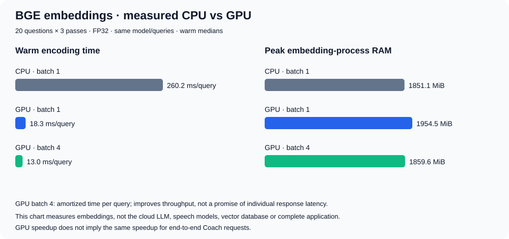
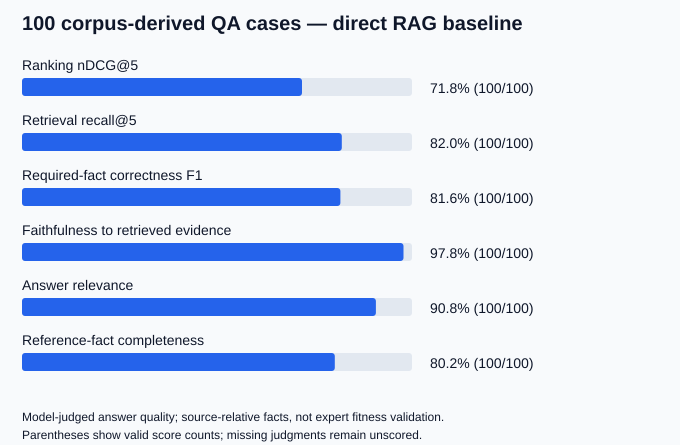

# Fitness Multi-Agent RAG

A personalized fitness coaching application with a Streamlit interface, three cooperating AI agents, retrieval-grounded workout planning, persistent coaching context, nutrition planning, and local speech input/output.

[](https://bmaged23.github.io/Fitness_multiagent_RAG/demo.html)

**4:54 narrated walkthrough:** login → coaching chat → plan structure → Week 1 exercises → approval and saving → weekly schedule → PDF download → STT → spoken reply → nutrition approval → both PDF downloads → open and scroll the documents.

[▶ Watch the demo](https://bmaged23.github.io/Fitness_multiagent_RAG/demo.html) · [Download MP4](https://raw.githubusercontent.com/bmaged23/Fitness_multiagent_RAG/master/docs/media/fitness-coach-demo.mp4) · [Recording notes](docs/demo-recording.md) · [Interactive architecture diagram](docs/architecture.html)

[Browser player](docs/demo.html) · [GitHub video publishing instructions](docs/video-publishing.md)

The **Watch demo** link opens the browser player hosted with GitHub Pages. The MP4 download link is available separately.

## How it works

[](docs/architecture.html)

Open the HTML file locally for clickable explanations and flow filters. GitHub shows the static image above.

- **Coach:** handles trainee intake, coaching conversation, profile/progress tools, nutrition plans, and delegation.
- **Program Designer:** proposes training structure, generates Week 1 exercises, validates plans, and supports approval, persistence, and revisions.
- **Retriever:** searches program and exercise collections in Qdrant, checks coverage, and expands retrieval when needed. Both Coach and Designer can delegate to it.
- **Voice:** faster-whisper transcribes recorded audio; Kokoro generates audio from replies.
- **Storage and exports:** SQLite holds profiles, plans, revisions, progress, and coaching memory; Streamlit displays schedules and exports workout PDFs.

Deep Agents/LangGraph orchestrates the agents. Groq or Ollama supplies the language model; sentence-transformers supplies local embeddings. Nutrition is handled through Coach tools, not a separate nutrition agent. Weekly schedules belong to workout plans, not a background scheduling service.

## Local compute and cloud inference

The main LLM runs on **Ollama Cloud** in the demonstrated configuration, so its weights and inference do not consume your computer's RAM or VRAM. The models running locally are **BGE embeddings** and, when voice is enabled, **Whisper STT and Kokoro TTS**. This keeps local model requirements lighter than hosting the main LLM on your own GPU. Streamlit, Qdrant, SQLite and the Python runtime still use local CPU and RAM.

The public CPU Docker image includes embeddings and text chat; STT/TTS are disabled there and use the optional GPU source setup. Actual resource use depends on enabled features, batch size and concurrent requests. Measured CPU/GPU latency and memory comparisons are shown below and documented separately from the 100-case answer-quality evaluation. Optional STT/TTS were not included in the CPU-image measurements.

## Latency and resource measurements



**BGE embedding worker:** the same 20 questions encoded three times on CPU and GPU (60 encodings per configuration). Warm statistics exclude the first batch.

| Configuration | Warm median | Warm p95 | Peak process RAM | Peak CUDA allocation | Throughput |
|---|---:|---:|---:|---:|---:|
| CPU · batch 1 | 260.25 ms | 336.81 ms | 1851.1 MiB | Not used | 3.74/s |
| GPU · batch 1 | 18.27 ms | 32.50 ms | 1954.5 MiB | 1289.9 MiB | 48.29/s |
| GPU · batch 4 | 12.96 ms | 15.92 ms | 1859.6 MiB | 1295.8 MiB | 75.14/s |

GPU single-query encoding was **14.24× faster** than CPU in this measurement. Batch-4 timing is amortized per query; it measures throughput rather than an individual user’s response latency. CPU/GPU vectors agreed to cosine similarity above 0.9999999999. GPU memory comes from PyTorch; RAM is sampled process RSS. These are embedding measurements, not whole-application figures.

**Actual CPU-image Coach:** five requests completed in **2.36–13.02 s**, median **3.30 s**, with peak process RAM **1.71 GiB**. The LLM ran on Ollama Cloud; no local LLM weights were loaded. One known-record lookup was missed, so completed timings are not correctness passes.

Recorded LLM calls accounted for about **96.2%** of these backend durations, including cloud/network wait. Model caching avoids repeated cold initialization; GPU acceleration and batching improve embedding performance, but do not imply the same whole-app speedup. The current UI buffers completed jobs; a native model’s streaming first-token time is not user-visible app latency.

[Full latency spread, CPU/RAM/VRAM, cold/warm results, token usage and reproduction commands](docs/PERFORMANCE.md).

## RAG evaluation

A frozen **100-question corpus-derived golden dataset** evaluates retrieval and generated answers. All 100 cases completed: **nDCG@5 0.7179**, **recall@5 82.00%**, **correctness F1 81.65%**, **completeness 80.20%**, and **faithfulness 97.83%**. Gemma generated answers; GPT-OSS 120B judged correctness and faithfulness separately through Ollama Cloud, with experiments in LangSmith.



See the [full results and limitations](evaluation/GOLDEN_QA_RESULTS.md). This is a direct retrieval → answer baseline; it does not certify the complete Coach/Designer workflow. References are mechanically source-validated rather than independently human-adjudicated. The older behavior scenarios remain a separate regression suite.

Latest automated release evaluation: **100/100 scored**, correctness F1 **81.50%**, completeness **80.20%**, relevance **90.00%**, faithfulness **99.00%**, and unsupported claims **1.00%**. Retrieval scores were unchanged. These are a separate run from the frozen baseline above. [Latest aggregate results](docs/performance/release-evaluation-7d09f5c.json).

### Evaluation process

1. **Build the golden dataset first:** inspect the corpus, select 100 source-first questions, and freeze their reference chunks, required facts and reference answers.
2. **Test retrieval:** embed each question with BGE, retrieve the top five Qdrant results and calculate nDCG, recall, precision and MRR against the reference sources.
3. **Generate answers:** Gemma receives only the question and actual retrieved evidence, without reference answers.
4. **Judge separately:** GPT-OSS 120B compares answers with gold facts for correctness/completeness/relevance, then makes a separate evidence-only assessment for faithfulness and unsupported claims.
5. **Record and gate releases:** Python validates and aggregates the scores; LangSmith records the experiments. CI requires 100 scored cases and limits regression before testing and publishing the Docker image.

Read the [complete evaluation process, formulas, results and limitations](docs/EVALUATION_PROCESS.md), including the original baseline and the subsequent successful CI run.

## Docker application and automated releases

The CPU image packages the Streamlit application, agents, PDF export and the pinned BGE embedding model. Workout data is provisioned separately into persistent volumes, and LLM access requires your own provider credentials. Optional GPU speech uses the source installation.

**Public image:** [https://hub.docker.com/r/bmaged23/fitness-multiagent-rag](https://hub.docker.com/r/bmaged23/fitness-multiagent-rag)

```bash
docker pull bmaged23/fitness-multiagent-rag:cpu
```

Follow [configuration, corpus provisioning and run instructions](docs/DOCKER.md) before starting grounded chat. The image includes BGE; you supply provider/Kaggle credentials and provision the corpus once. **[Verified CI/CD release](https://github.com/bmaged23/Fitness_multiagent_RAG/actions/runs/39881688307): 132 offline tests, all 100 live QA cases, quality gate, image smoke checks, publication and public-image pull checks passed.** See [release evidence](docs/RELEASE_VERIFICATION.md).

The 100-case quality evaluation runs from the checked-out source on the local GPU; Docker smoke checks run against the built image before and after publication.

[CI/CD setup](docs/CI_CD.md) explains the offline tests, fresh **100-case live evaluation**, quality regression gate and Docker Hub publication. The GPU evaluation runner is registered and configured with private frozen fixtures. Image publication depends on the evaluation passing; the laptop runner and Qdrant must be online for future releases.

## Development checks

For the offline application test suite (no GPU, model download or cloud key required):

```bash
python3.12 -m venv .venv
source .venv/bin/activate
python -m pip install -r requirements-dev.txt
python -m pip check
python -m pytest -q
node tests/microphone_status.mjs
```

`requirements-core.txt` is the resolved text application/PDF dependency set. Local embedding inference and optional speech require their additional dependencies and model assets; the core environment alone is not a provisioned RAG installation. Three live-agent scripts are excluded from the default pytest run. See [release verification progress](docs/RELEASE_PROGRESS.md) for tested routes and remaining work.

## Clone and run

The default source installation uses **Linux/WSL2, Python 3.12 and CPU embeddings**. GPU hardware is optional for text chat. The image targets Linux amd64; see [Docker instructions](docs/DOCKER.md) for Windows/macOS through Docker Desktop. Optional local speech requires NVIDIA CUDA and additional packages/models.

`requirements.txt` installs the fully pinned CPU runtime from `requirements-runtime.txt`, including embeddings, PDF export and corpus preparation/download dependencies. `requirements-dev.txt` is the smaller offline-test environment. The older GPU demonstration snapshot is preserved in [original-demo-requirements.txt](docs/reference/original-demo-requirements.txt); it is historical and is not the fresh-install route.

### 1. Clone and install

```bash
git clone https://github.com/bmaged23/Fitness_multiagent_RAG.git
cd Fitness_multiagent_RAG
python3.12 -m venv .venv
source .venv/bin/activate
python -m pip install -r requirements.txt
python -m pip check
cp .env.example .env
```

Allow several GB of disk for packages, the 1.3 GB BGE encoder, corpus and optional speech models. The container uses this same pinned CPU runtime. Cloud LLM access requires internet and your own credentials.

### 2. Configure `.env`

Edit the copied `.env` locally. Never commit API keys.

| Setting | Purpose |
| --- | --- |
| `LLM_PROVIDER` | `groq` or `ollama` |
| `GROQ_API_KEY`, `GROQ_MODEL` | Required when using Groq; choose a model available to your account |
| `OLLAMA_BASE_URL`, `OLLAMA_MODEL`, `OLLAMA_API_KEY` | The example uses Ollama cloud; cloud needs a key and accessible model |
| `QDRANT_URL` | Local Compose service: `http://localhost:6333` |
| `EMBEDDING_MODEL`, `EMBEDDING_DIM` | Defaults: `BAAI/bge-large-en-v1.5`, `1024`; keep the vector size consistent |
| `KAGGLE_USERNAME`, `KAGGLE_KEY` | Needed for the dataset download in step 4 |
| `TAVILY_API_KEY` | Enables optional web-search tools |

For a local Ollama server, set `OLLAMA_BASE_URL=http://localhost:11434`, choose an installed model in `OLLAMA_MODEL`, and leave `OLLAMA_API_KEY` empty. Install Ollama and pull that model separately before starting chat. Qdrant authentication can be supplied through `QDRANT_API_KEY` when using an authenticated server.

SQLite defaults to `data/fitness_coach.db`; set `SQLITE_DB_PATH` to override it (for example, a mounted container data directory). Back up existing personal data before replacing the database.

### 3. Start storage

```bash
docker compose -f docker/docker-compose.yml up -d
docker compose -f docker/docker-compose.yml ps
curl --fail http://localhost:6333/healthz
python scripts/init_db.py
```

This storage-only Compose file starts Qdrant. The separate `docker/compose.app.yml` runs both storage and the application image. SQLite initialization creates application tables. Qdrant vectors persist in the Compose volume; SQLite persists under `data/`.

### 4. Download and index the workout corpus

Get Kaggle credentials using the [official Kaggle CLI instructions](https://github.com/Kaggle/kaggle-cli). The downloader accepts `KAGGLE_USERNAME` and `KAGGLE_KEY`, or a configured `~/.kaggle/kaggle.json`.

```bash
python scripts/download_dataset.py
python scripts/chunk_data.py
python scripts/embed_and_index.py --reseting
python scripts/inspect_collections.py
```

The source dataset is `adnanelouardi/600k-fitness-exercise-and-workout-program-dataset`. Downloaded CSV files go to `data/raw/`; program and exercise chunks go to `data/processed/`. Embedding downloads the configured model and fills the `fitness_programs` and `fitness_exercises` Qdrant collections. Complete indexing before asking for grounded training plans.

**Index reset behavior:** `--reseting` explicitly deletes and recreates both collections. Without it, indexing preserves existing collections and upserts; missing collections are created on the first indexing run. For later upserts, run:

```bash
python scripts/embed_and_index.py --no-reseting
```

### 5. Optional GPU speech

The default install is ready for text chat. To enable voice, install a CUDA-enabled PyTorch build for your hardware and the pinned optional speech packages. This optional GPU route has not been reinstalled cleanly during this release; the recorded demonstration used a different runtime. Keep `ENABLE_SPEECH=false` for the CPU route.

```bash
python -m pip install -r requirements-speech.txt
python scripts/download_speech_models.py
python -c "import torch; print('Torch:', torch.__version__, 'CUDA:', torch.version.cuda, 'GPU available:', torch.cuda.is_available())"
```

This downloads English `Systran/faster-whisper-base.en` for STT and `hexgrad/Kokoro-82M` with the configured voices for TTS. Models are cached locally. The spaCy English model is pinned through its release-wheel URL in `requirements-speech.txt`. See [faster-whisper's GPU requirements](https://github.com/SYSTRAN/faster-whisper) if CUDA or cuDNN libraries fail to load. Successful Torch GPU detection alone does not validate Whisper inference.

### 6. Launch and try the application

```bash
python -m streamlit run app/streamlit_app.py
```

Open `http://localhost:8501`. Sign up, log in, and provide your goal, experience, equipment, available days, and any training limitations. Try: “Create a six-week beginner dumbbell plan, three days per week.” Review the proposed structure, request Week 1 details, then explicitly approve saving the plan. Open **My plans** to inspect the weekly schedule and download its PDF. Nutrition plans can also be drafted, approved, and revised through chat.

With optional GPU speech configured and `ENABLE_SPEECH=true`, allow browser microphone access on localhost to record speech, review/send the transcription, and use the reply audio controls to hear generated speech. Voice requires the downloaded models and working GPU/runtime configuration. PDF export requires no additional package installation. The [recorded demo](https://raw.githubusercontent.com/bmaged23/Fitness_multiagent_RAG/master/docs/media/fitness-coach-demo.mp4) shows these interactions.

The terminal alternative is:

```bash
python src/fitness_multiagent_rag/agents/coach/main.py
```

Use Ctrl+C to end a terminal session and run session finalization. Stop Qdrant with `docker compose -f docker/docker-compose.yml down`; avoid `down -v` unless you intend to delete its stored vectors.

### Troubleshooting

- **Docker connection fails:** start Docker/Desktop, enable WSL integration when applicable, then rerun the storage commands.
- **Missing vectors or poor retrieval:** verify the dataset files and both collections using the indexing steps and `inspect_collections.py`.
- **Provider authentication/model errors:** check the selected provider, key, URL, and account-accessible model in `.env`.
- **Speech dependency check fails on Python 3.13:** the recorded environment has two known Python-version metadata conflicts (Kokoro and Misaki). Recreate the virtual environment with Python 3.12 rather than silently ignoring dependency checks.
- **Microphone unavailable:** grant browser permissions and access through localhost or HTTPS.
- **Port in use:** choose another Streamlit port with `--server.port 8502`.

## Project layout

```text
app/                         Streamlit UI, chat, plan views, and audio controls
config/                      Environment and runtime settings
src/fitness_multiagent_rag/
  agents/                    Coach, Designer, Retriever, prompts, and tools
  db/                        SQLite access and persisted training/nutrition data
  memory/                    Persistent coaching context
  schemas/                   Typed profiles and plans
  speech/                    Whisper STT and Kokoro TTS
  vectorstore/               Qdrant retrieval and embeddings
scripts/                     Dataset, indexing, schema, and speech-model setup
db/                          SQL schemas
docker/                      Application Dockerfile and storage/application Compose stacks
tests/                       Offline regressions and live integration runners
docs/                        Architecture, demonstration, and reference material
```

## Offline verification

```bash
PYTHONPATH=.:src python -m pytest tests/test_draft_routing.py tests/test_streamlit_app.py tests/test_speech.py tests/test_plan_pdf.py
```

These regression targets avoid live provider integration runners. `tests/test_coach.py`, `test_designer.py`, and `test_retriever.py` interact with configured external services and can write application data. Published retrieval and answer-quality results are linked above. Full application latency and monetary cost have not been established.

## Additional documentation

The original detailed design reference is preserved in [docs/reference/project-design-notes.md](docs/reference/project-design-notes.md). Historical design notes may differ from the running implementation.
