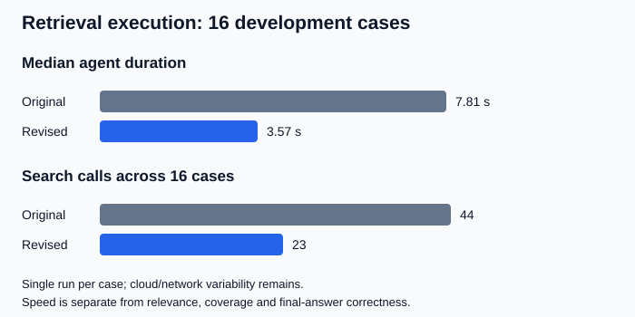

# Retrieval development pilot

Recorded 22–23 October 2026. This evaluates the Retriever component on **16 development scenarios**, not the entire app or all 100 scenarios.

| Measurement | Original retriever | Revised retriever |
|---|---:|---:|
| Parsed JSON outputs | 16/16 | 16/16 |
| Median agent duration | 7.81 s | 3.57 s |
| Search calls across 16 cases | 44 | 23 |
| Cases returning evidence | 16/16 | 13/16 |
| Detected evidence provenance issues | 0 | 0 |
| Cases receiving a valid LLM rating | 16/16 | 12/16 |
| Documents the judge rated relevant | 31/57 rated | 30/30 rated |

**Do not interpret the last row as whole-project accuracy or a directly comparable improvement percentage.** The revised outputs contain fewer documents, three cases returned no evidence, and one additional case failed judge validation. Empty/error cases are not counted as perfect results.

## What changed

The original prompt contained placeholder allowed-value lists, instructed searches of both collections on every request, relaxed filters after empty results, and forced selection even when retrieved evidence was unrelated. The revised prompt supplies the actual categories, chooses collections by task, preserves explicit constraints and allows abstention. Qdrant point IDs now survive into agent evidence; exercise display names are also preserved.

## What needs attention

- `retrieval-20`: the first revised retriever discarded usable exercise-statistic evidence. A further general statistics-evidence instruction fixed this in a targeted rerun: one source returned, one search, 4.23 s, no detected provenance issues. The 16-case revised timings above predate this follow-up; replay the matrix before a final release.
- `retrieval-13`: judge output failed strict ID validation. Its documents remain unscored; malformed model ratings must never become a score silently.
- Judge interpretation of Beginner versus Novice and numerical metadata inconsistencies needs human calibration. A judge disagreement is not automatically an application failure.
- The unknown-title case and the advanced ten-minute case returned empty revised outputs; whether abstention is correct must be checked against the frozen corpus and user constraints, not inferred merely from an empty response.

## Execution and resources

Local Qdrant contained 2,594 program and 3,213 exercise records. The pinned query encoder was BAAI/bge-large-en-v1.5, revision `d4aa6901d3a41ba39fb536a557fa166f842b0e09`, using CUDA on the GTX 1660 Ti. The cloud retrieval model was Gemma 4 31B; the judge was gpt-oss:120b through Ollama Cloud.

The separate direct-query embedding run reported about 1292 MiB peak allocated CUDA memory and 2058 MiB process max RSS. Model loading and the first batch were cold; these are not per-agent-case resource measurements. Local batching times are not time to first user-visible answer.

LangSmith records datasets, traces and model judgments; Python runs the harness locally and Ollama Cloud runs the judge. Mistral Large 3 returned HTTP 402 because it is excluded from current free usage, so the requested two-judge comparison is unfinished. No credits were purchased and no price estimate was invented.

[Baseline review](https://eu.smith.langchain.com/o/01cb8af4-5866-49ad-bca6-26844f87da18/projects/p/ab640d96-be69-4ae7-9787-98644e04d177) · [Revised review](https://eu.smith.langchain.com/o/01cb8af4-5866-49ad-bca6-26844f87da18/projects/p/5a57ab14-3472-4861-8743-9aefda20d26e) (workspace access required).

Raw corpus snapshots, full traces and judgments remain in ignored `.evaluation-local/`. [Aggregate machine-readable results](results/retrieval-development-pilot.json).

## Remaining evaluation work

Replay the full matrix after the targeted statistics fix, calibrate judge rubrics, review corpus-backed relevance references, implement isolated full-conversation fixtures, evaluate Coach/Designer and multi-turn memory on development cases, then freeze a candidate and run the 70 held-out scenarios without tuning on their outcomes. Full RAG correctness, groundedness of final answers, human-calibrated quality, complete resource profiling and a second-judge comparison are not complete.
